<p align="center">
  
</p>

Radar de precios de Gunpla en Chile. Recorre automáticamente 8 tiendas especializadas, agrupa en un solo producto las publicaciones de un mismo modelo y guarda el historial de precios de cada tienda para ver cómo cambian en el tiempo.

Es una aplicación web en **Flask** con su propia base **SQLite**: no depende de servicios externos ni de APIs de las tiendas, y el scraping respeta el `robots.txt` de cada una.

> **Estado:** catálogo público, ficha de producto con gráfico, panel de administración y scraping programado funcionando. Siguiente paso: cuentas de usuario con favoritos.

## Capturas

<!-- Sin tabla: en una tabla GitHub ajusta cada columna al texto y las imágenes quedan de distinto tamaño. -->
<p align="center">
  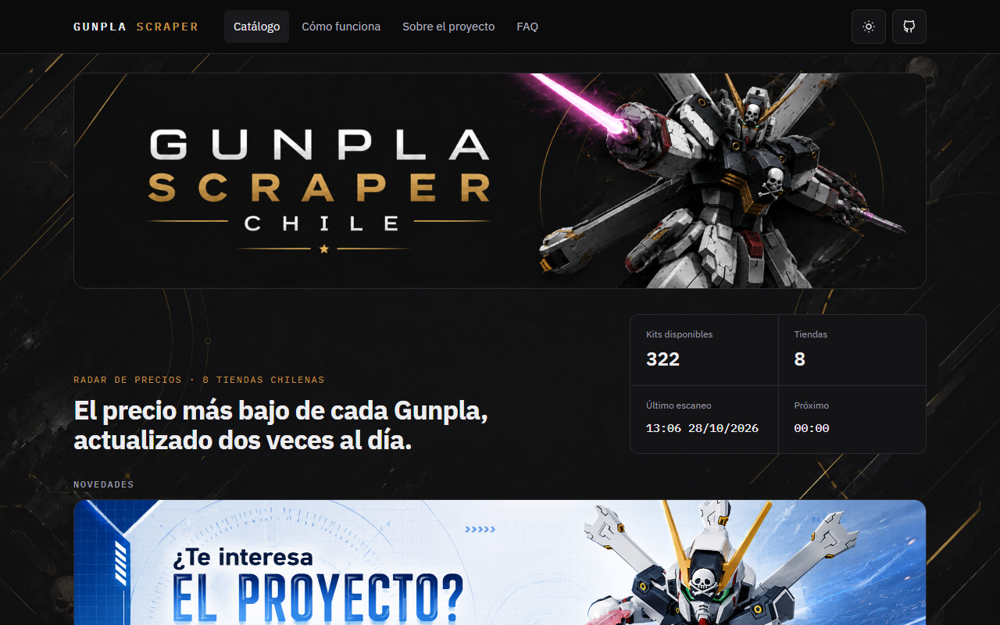
  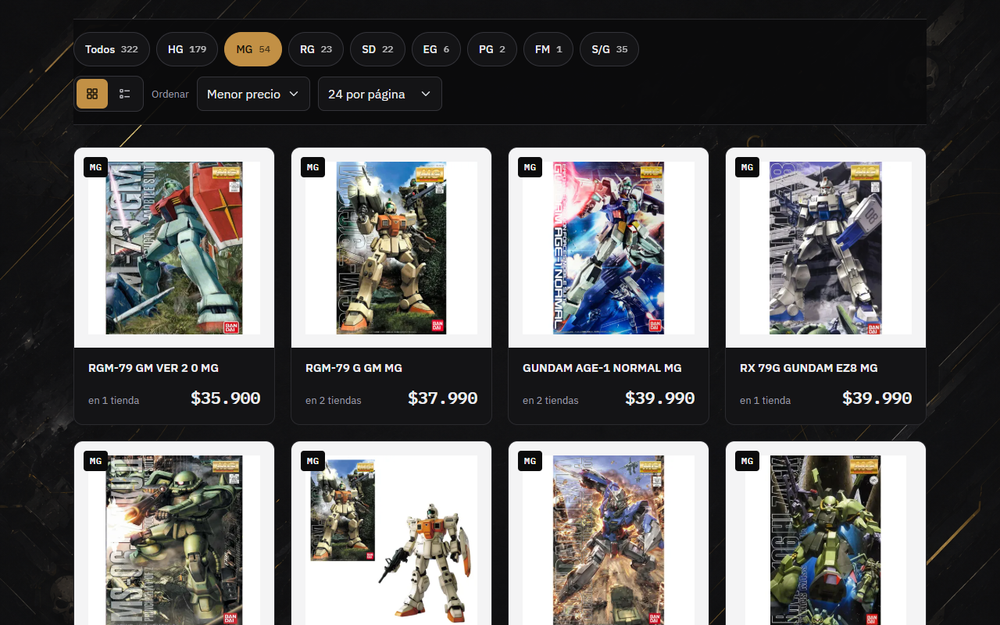
</p>
<p align="center">
  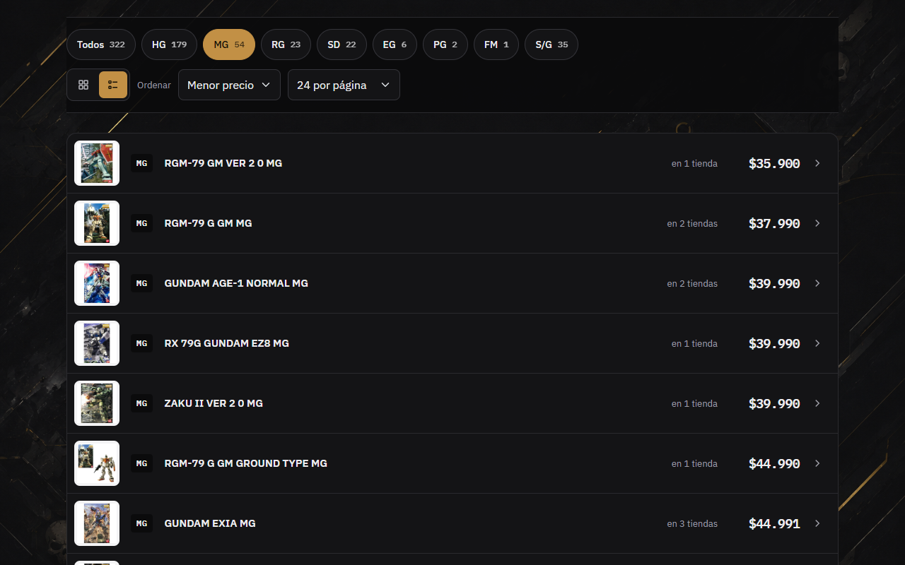
  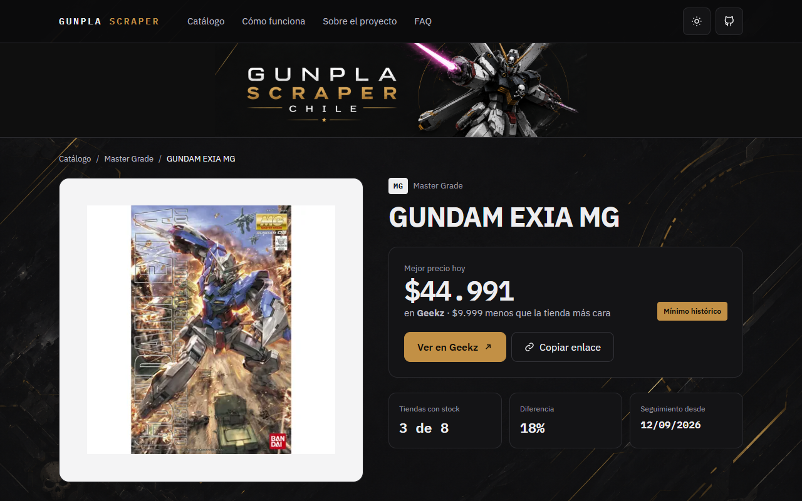
</p>
<p align="center">
  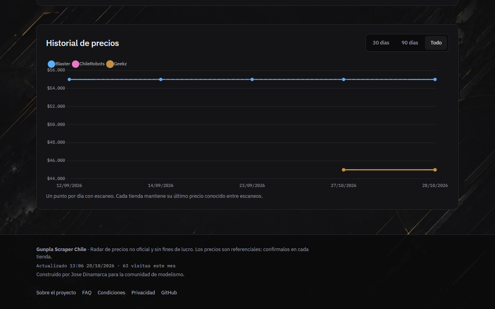
  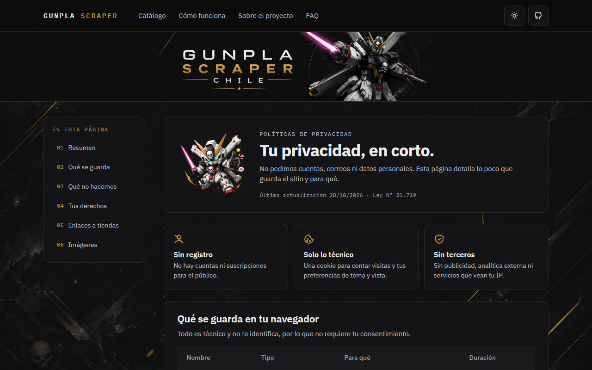
</p>

- **Inicio:** banner, cifras del radar (kits, tiendas, último y próximo escaneo), carrusel de novedades y buscador.
- **Catálogo:** filtros por grado con la cantidad de kits de cada uno, orden por precio o nombre, y vista en cuadrícula o en lista que el navegador recuerda.
- **Producto:** mejor precio y tienda, ahorro frente a la más cara, sello de mínimo histórico, tabla por tienda con el título original de cada una y gráfico del historial.
- **Modo claro y oscuro:** se cambia con un botón y el navegador lo recuerda. Las capturas están en modo oscuro, el tema por defecto.
- **Interfaz:** Bootstrap 5 con IBM Plex y los colores del banner, adaptada a celular. Fuentes, estilos y librerías se sirven desde el sitio, sin CDN ni servicios externos.

### Panel de administración

<p align="center">
  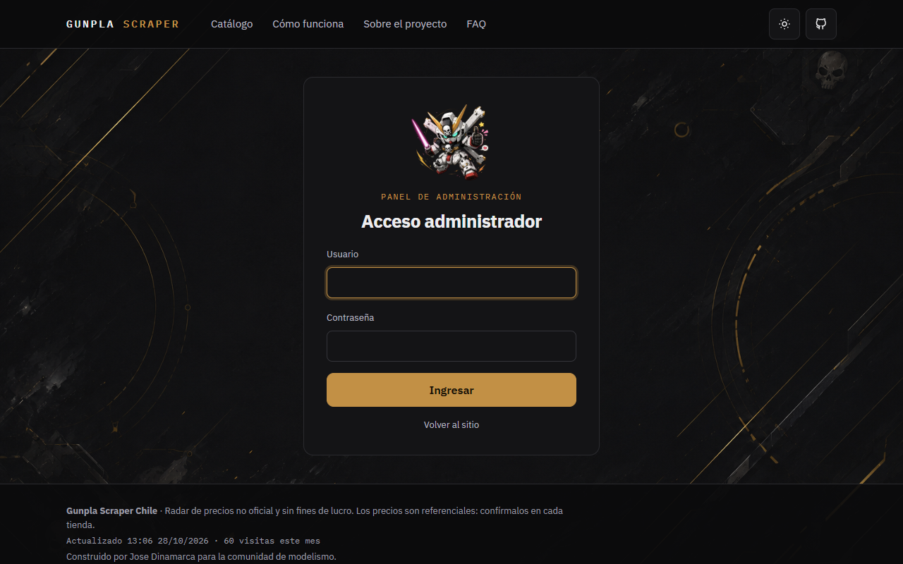
  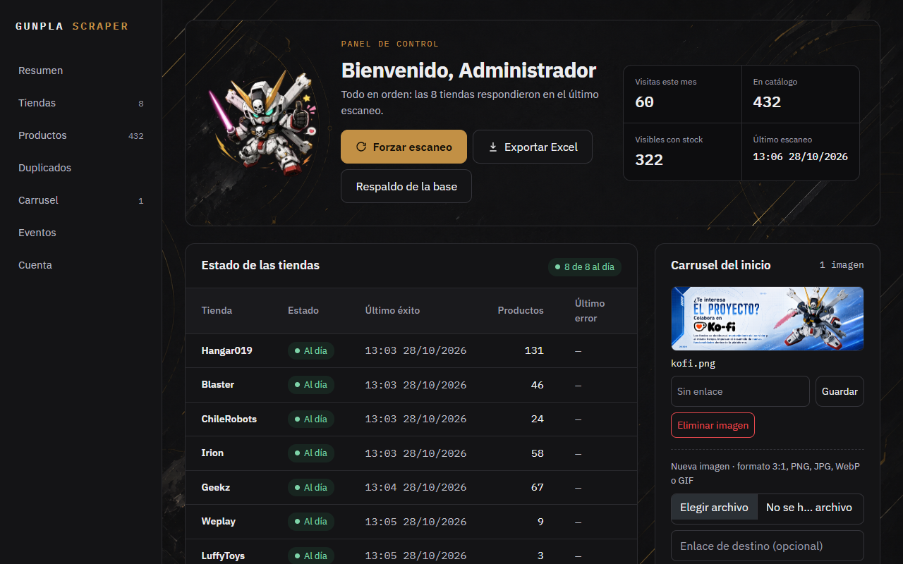
</p>
<p align="center">
  
  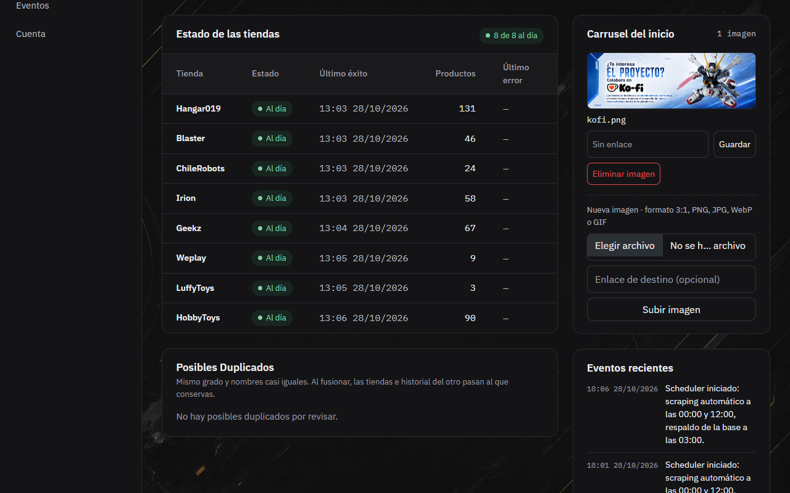
</p>
<p align="center">
  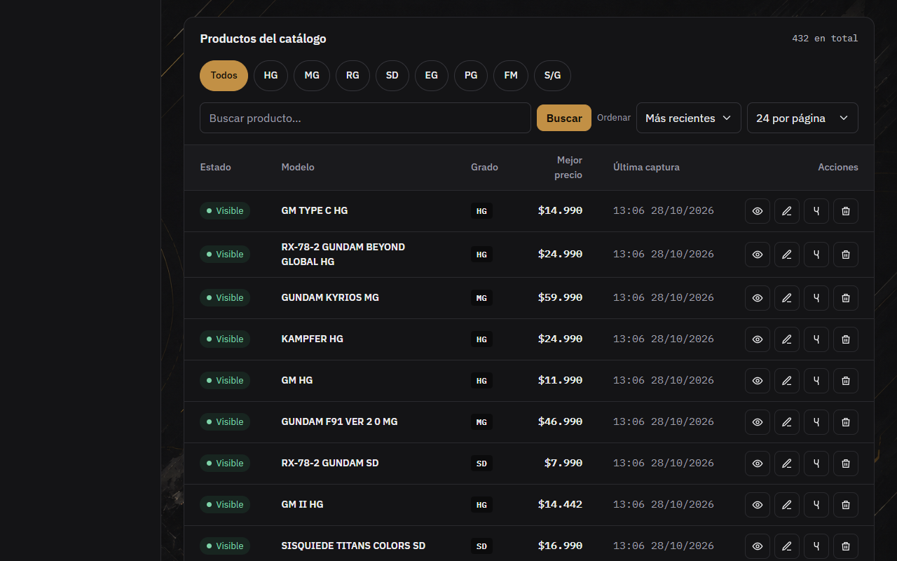
  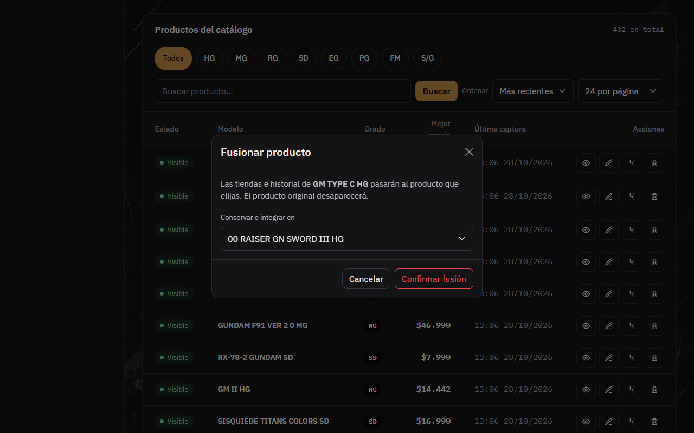
</p>
<p align="center">
  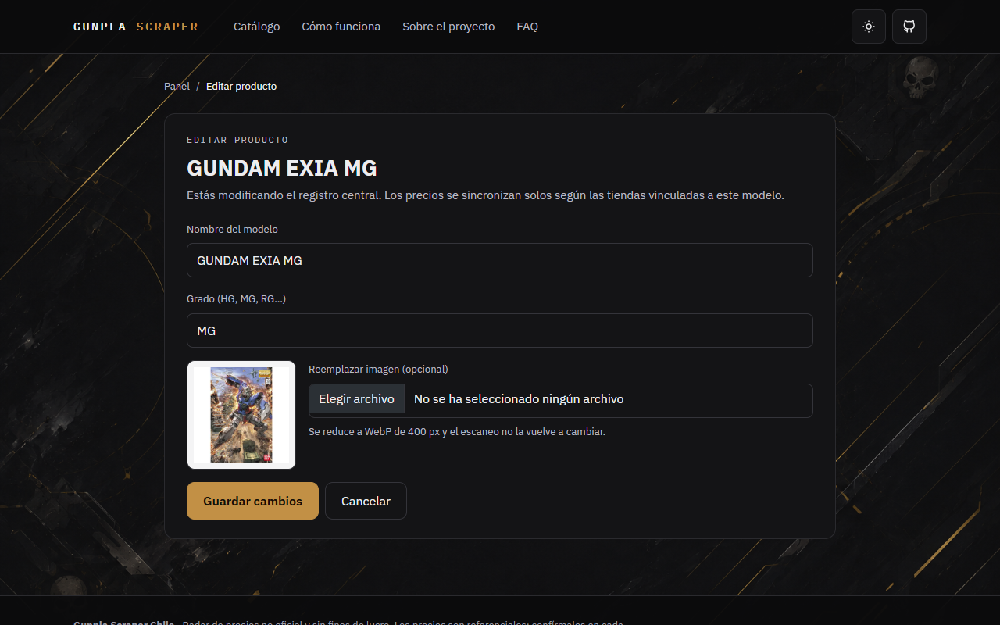
</p>

- **Acceso:** usuario y contraseña. Al cambiarlos desde el panel, la contraseña se guarda como hash.
- **Resumen:** visitas del mes, productos en catálogo, visibles con stock y último escaneo, con los botones para forzar un escaneo, exportar a Excel y descargar un respaldo de la base. Avisa si el último escaneo exitoso tiene más de 48 horas.
- **Estado de las tiendas:** último escaneo exitoso, productos y último error de cada tienda; marca para revisar las que llevan más de 48 horas sin un escaneo exitoso o fallaron en el último intento.
- **Posibles duplicados:** pares del mismo grado con nombres casi iguales, para fusionarlos o marcarlos como distintos.
- **Carrusel y eventos:** imágenes del carrusel del inicio con su enlace, y el registro de las últimas acciones y escaneos.
- **Productos:** ordenados por estado (Visibles → No disponibles → Ocultos), con acciones para ocultar, editar, eliminar y fusionar.
- **Fusión:** pasa las tiendas y el historial de un duplicado al producto principal.
- **Edición:** nombre estandarizado, grado e imagen de cada modelo.
- **Cuenta:** cambio de usuario y contraseña del panel.

## Funciones

**Ya funcionan:**

- **Catálogo** con paginación de 24, 48 o 120 productos, filtro por grado (PG, MG, RG, HG, EG, SD, FM, S/G) y orden por precio (ascendente o descendente) o alfabético.
- **Ficha de producto** con el precio y el enlace de cada tienda, y un gráfico con *Chart.js* del historial de precios por tienda.
- **Imágenes de los productos:** se toman de los listados de las tiendas durante el escaneo (sin peticiones extra), se descargan una sola vez por producto y se guardan reducidas a WebP de 400 px (unos 5 a 25 KB) en `static/productos/`. Desde el panel se puede reemplazar la imagen de cualquier producto.
- **Compartir y buscadores:** cada producto tiene una URL con su nombre (`/producto/45-gfred-hg`; las antiguas redirigen) y, al compartirlo en WhatsApp o redes, aparece con su foto y el precio más bajo. `sitemap.xml` lista los productos visibles y `robots.txt` deja el panel fuera de los buscadores.
- **Disponibilidad automática:** un producto sin stock en ninguna tienda pasa a "No disponible" y sale del catálogo, sin perder el estado Visible/Oculto que eligió el administrador.
- **Catálogo estandarizado:** el nombre que publica cada tienda se limpia (marcas, escalas, texto de relleno), se detecta su grado y se agrupa con las publicaciones del mismo modelo en otras tiendas.
- **Filtro de palabras bloqueadas:** descarta solo los productos de otras franquicias (Pokémon, Naruto, Dragon Ball…) que algunas tiendas mezclan en su catálogo.
- **Scraping programado** todos los días a las 00:00 y 12:00. Al terminar se normaliza el catálogo y se recalcula la disponibilidad. También se puede lanzar a mano desde el panel.
- **Panel de administración:**
  - Acceso con usuario y contraseña. Las credenciales iniciales vienen del `.env`; al cambiarlas desde el panel, la contraseña se guarda como hash (Werkzeug).
  - Listado ordenado siempre Visibles → No disponibles → Ocultos, sea cual sea el orden elegido.
  - Crear, editar, ocultar y eliminar productos.
  - **Fusionar duplicados:** las publicaciones del ID duplicado pasan al principal, con todo su historial.
  - **Posibles duplicados:** el panel sugiere pares del mismo grado con nombres casi iguales (orden de palabras, guiones, "GUNDAM" de más, una letra de diferencia) para fusionarlos con un clic o marcarlos como distintos.
  - Carrusel de imágenes con enlace y orden editables (solo acepta PNG, JPG, WebP y GIF).
  - Descarga de la base de datos completa y reporte de precios en Excel.
  - Todas las acciones que modifican datos van por POST con token CSRF, y la cookie de sesión es `SameSite=Lax`.
- **Métricas y registro:** visitas únicas por mes (una por visitante al día, con cookie) y registro de las acciones del panel y de cada corrida de scraping.
- **Páginas institucionales:** Sobre Nosotros, Preguntas Frecuentes, Condiciones de Servicio y Políticas de Privacidad.

**Próximos pasos:**

- **Cuentas de usuario y favoritos:** las tablas `usuarios` y `favoritos_usuario` ya existen; falta el registro y la interfaz.

## Tiendas monitoreadas

Hangar019 · Blaster Chile · ChileRobots · Irion Juguetería · Geekz · Weplay · LuffyToys · HobbyToys

Cada tienda se evaluó contra su `robots.txt` antes de integrarla. Mirax, Top8, Bluecard y Wargaming quedaron fuera porque bloquean el acceso automatizado a su catálogo; el detalle está en las Preguntas Frecuentes del sitio.

## Scraping responsable

- Solo se recorren tiendas cuyo `robots.txt` lo permite.
- Los scrapers hacen pausas (`time.sleep`) entre páginas para no cargar los servidores de las tiendas.
- Solo se guardan datos públicos de los productos: nombre, precio, imagen y enlace.
- Cada producto enlaza a la tienda: la compra siempre se hace allá.

## Tecnología

| Pieza | Elección |
|---|---|
| Servidor y plantillas | Python + Flask (Blueprints) + Jinja2 |
| Base de datos | SQLite, con migraciones no disruptivas al iniciar |
| Scraping | Requests + BeautifulSoup4; cloudscraper para la tienda protegida por Cloudflare |
| Tareas programadas | APScheduler (trigger `cron`, dentro del mismo proceso) |
| Gráficos | Chart.js |
| Reportes | pandas + openpyxl (`.xlsx`) |
| Interfaz | Bootstrap 5 + IBM Plex, con variables CSS propias (tema claro y oscuro); todo servido desde el sitio, sin CDN |

### Base de datos

Versión simplificada con las tablas principales; el detalle de las 9 tablas, con sus columnas, está en [docs/BASE-DE-DATOS.md](docs/BASE-DE-DATOS.md).

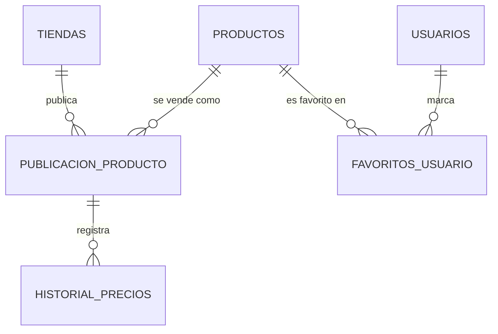

- Un **producto** es el modelo estandarizado (nombre, grado, imagen, visible, disponible).
- Una **publicación** es ese producto en una tienda concreta, con su URL y precio actual.
- El **historial** guarda cada precio observado de una publicación, con su fecha.
- Además: `banners` (carrusel), `visitas_mensuales` y `logs`.

## Ejecutar

Requisitos: Python 3.10 o superior.

Crea un entorno virtual en la carpeta del proyecto e instala las dependencias ahí (la carpeta `.venv` no va al repositorio):

```bash
python -m venv .venv
```

```bash
.venv\Scripts\python -m pip install -r requirements.txt
```

En Linux o macOS la ruta es `.venv/bin/python`. Desde ahí, todos los comandos se corren con ese Python (por ejemplo `.venv\Scripts\python app.py`), o activando el entorno antes con `.venv\Scripts\Activate.ps1` en PowerShell.

Crea un archivo `.env` en la raíz con las credenciales iniciales del panel y la clave de sesión de Flask:

```env
ADMIN_USER=tu_usuario
ADMIN_PASS=tu_contraseña
SECRET_KEY=una_cadena_larga_y_aleatoria
```

Las tres son obligatorias: sin ellas la app no arranca.

```bash
.venv\Scripts\python app.py
```

La app se sirve con [Waitress](https://docs.pylonsproject.org/projects/waitress/) en `http://127.0.0.1:5000` y el panel queda en `/admin`. La base `precios_comunidad.db` se crea al primer inicio y se llena con el primer scraping (programado, o a mano desde el panel).

Variables opcionales del `.env`:

| Variable | Por defecto | Uso |
|---|---|---|
| `HOST` | `127.0.0.1` | `0.0.0.0` para aceptar conexiones desde otros equipos |
| `PORT` | `5000` | Puerto del sitio |
| `FLASK_DEBUG` | apagado | `1` usa el servidor de desarrollo de Flask con depuración. **Nunca en un sitio publicado**: la consola de depuración permite ejecutar código en el servidor |
| `HTTPS` | apagado | `1` cuando el sitio se publica con https: las cookies solo se envían cifradas. En local (http) dejarlo apagado, o no se puede iniciar sesión en el panel |

Todos los días a las 03:00 se guarda una copia de la base en `respaldos/precios_AAAA-MM-DD.db`, y se borran las de más de 30 días. La carpeta no va al repositorio.

Las pruebas usan una base temporal y no tocan `precios_comunidad.db`:

```bash
.venv\Scripts\python -m unittest discover tests
```

Cada push las corre también en GitHub Actions, con Python 3.10 y con la versión más reciente (pestaña **Actions** del repositorio).

> El scheduler arranca con `python app.py` y corre dentro de ese proceso: el scraping automático solo ocurre mientras la app está encendida. Importar `app.py` (por ejemplo desde un servidor WSGI) no lo arranca; en ese caso hay que llamar a `iniciar_scheduler()` en un único proceso.

## Estructura

```
app.py                       Punto de entrada: Flask, blueprints y scheduler
config.py                    Configuración y variables del .env
core/                        Toda la lógica y el SQL; las rutas solo atienden HTTP
├── database.py              Conexión, transacciones, creación de tablas y migraciones
├── catalogo.py              Listados del inicio y del panel, y ficha de producto
├── productos.py             Editar, ocultar, eliminar, fusionar y crear productos
├── carrusel.py              Imágenes del carrusel
├── usuarios.py              Credenciales del administrador
├── estadisticas.py          Resumen y alerta del panel
├── exportar.py              Reporte en Excel
├── seguridad.py             Token CSRF
├── precios.py               Conversión de precios a número
├── imagenes.py              Imágenes de productos: URL desde el listado, descarga única y WebP
├── peticiones.py            Peticiones a las tiendas con reintentos (429, 5xx, cortes)
├── scraper_manager.py       Orquestador: corre cada scraper y guarda los resultados
├── catalog_manager.py       Limpieza de nombres, grado y palabras bloqueadas
└── logger.py                Registro de eventos (tabla logs)
routes/
├── public/                  Inicio, producto e institucionales
└── admin/                   Login y panel de administración
scrapers/                    Un módulo por tienda (8)
templates/
├── base.html                Plantilla común: menú, tema, banner y pie (Bootstrap)
├── public/                  Inicio, producto e institucionales
└── admin/                   Login, panel y edición
    └── panel/               Secciones del panel (resumen, tiendas, duplicados, carrusel, eventos, productos, cuenta, fusión)
static/                      tema.css, JS, Bootstrap y fuentes locales, banners, mascotas y carrusel
tests/                       Pruebas de regresión (unittest)
docs/
├── BASE-DE-DATOS.md         Tablas, columnas y procesos que modifican los datos
├── SCRAPERS.md              Flujo del scraping, normalización y cómo agregar una tienda
├── ER_model.png             Diagrama entidad-relación completo
└── capturas/                Imágenes de este README
```

## Nota de uso

Proyecto con fines educativos y de análisis personal. Los precios pueden no estar al día: el precio válido es siempre el de la tienda. Más detalles en las páginas Sobre Nosotros y Preguntas Frecuentes del sitio.

## Documentación

- [Base de datos](docs/BASE-DE-DATOS.md)
- [Scrapers](docs/SCRAPERS.md)
- [Diagrama entidad-relación](docs/ER_model.png)
