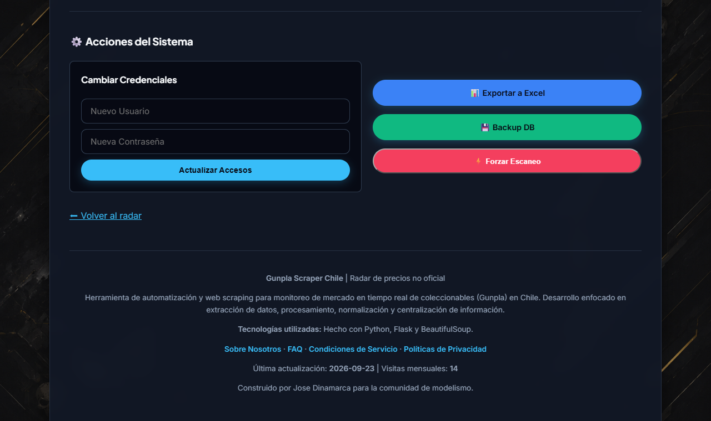
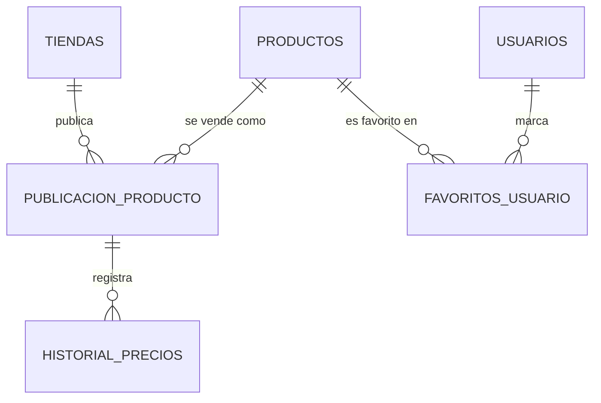

<p align="center">
  
</p>

Radar de precios de Gunpla en Chile. Recorre automáticamente 8 tiendas especializadas, agrupa en un solo producto las publicaciones de un mismo modelo y guarda el historial de precios de cada tienda para ver cómo cambian en el tiempo.

Es una aplicación web en **Flask** con su propia base **SQLite**: no depende de servicios externos ni de APIs de las tiendas, y el scraping respeta el `robots.txt` de cada una.

> **Estado:** catálogo público, ficha de producto con gráfico, panel de administración y scraping programado funcionando. Siguiente paso: cuentas de usuario con favoritos.

## Capturas

<!-- Sin tabla: en una tabla GitHub ajusta cada columna al texto y las imágenes quedan de distinto tamaño. -->
<p align="center">
  
  
</p>

- **Inicio:** catálogo con filtros por grado, buscador, orden por precio o nombre, y carrusel de promociones.
- **Producto:** precio y disponibilidad en cada tienda, con el gráfico de su historial.
- **Modo claro y oscuro:** se cambia con un botón y el navegador lo recuerda. Las capturas están en modo oscuro, el tema por defecto.

### Panel de administración

<p align="center">
  
  
</p>
<p align="center">
  
  
</p>
<p align="center">
  
  
</p>

- **Acceso:** usuario y contraseña. Al cambiarlos desde el panel, la contraseña se guarda como hash.
- **Resumen:** visitas del mes, modelos en catálogo, último escaneo y los últimos eventos del registro. Avisa si el último escaneo exitoso tiene más de 48 horas.
- **Productos:** ordenados por estado (Visibles → No disponibles → Ocultos), con acciones para ocultar, editar, eliminar y fusionar.
- **Fusión:** pasa las tiendas y el historial de un duplicado al producto principal.
- **Edición:** nombre estandarizado y grado de cada modelo.
- **Acciones del sistema:** cambiar credenciales, exportar a Excel, descargar la base y forzar un escaneo.

## Funciones

**Ya funcionan:**

- **Catálogo** con paginación de 24, 48 o 120 productos, filtro por grado (PG, MG, RG, HG, EG, SD, FM, S/G) y orden por precio (ascendente o descendente) o alfabético.
- **Ficha de producto** con el precio y el enlace de cada tienda, y un gráfico con *Chart.js* del historial de precios por tienda.
- **Disponibilidad automática:** un producto sin stock en ninguna tienda pasa a "No disponible" y sale del catálogo, sin perder el estado Visible/Oculto que eligió el administrador.
- **Catálogo estandarizado:** el nombre que publica cada tienda se limpia (marcas, escalas, texto de relleno), se detecta su grado y se agrupa con las publicaciones del mismo modelo en otras tiendas.
- **Filtro de palabras bloqueadas:** descarta solo los productos de otras franquicias (Pokémon, Naruto, Dragon Ball…) que algunas tiendas mezclan en su catálogo.
- **Scraping programado** todos los días a las 00:00 y 12:00. Al terminar se normaliza el catálogo y se recalcula la disponibilidad. También se puede lanzar a mano desde el panel.
- **Panel de administración:**
  - Acceso con usuario y contraseña. Las credenciales iniciales vienen del `.env`; al cambiarlas desde el panel, la contraseña se guarda como hash (Werkzeug).
  - Listado ordenado siempre Visibles → No disponibles → Ocultos, sea cual sea el orden elegido.
  - Crear, editar, ocultar y eliminar productos.
  - **Fusionar duplicados:** las publicaciones del ID duplicado pasan al principal, con todo su historial.
  - Carrusel de imágenes con enlace y orden editables.
  - Descarga de la base de datos completa y reporte de precios en Excel.
- **Métricas y registro:** visitas únicas por mes (una por visitante al día, con cookie) y registro de las acciones del panel y de cada corrida de scraping.
- **Páginas institucionales:** Sobre Nosotros, Preguntas Frecuentes, Condiciones de Servicio y Políticas de Privacidad.

**Próximos pasos:**

- **Cuentas de usuario y favoritos:** las tablas `usuarios` y `favoritos_usuario` ya existen; falta el registro y la interfaz.

## Tiendas monitoreadas

Hangar019 · Blaster Chile · ChileRobots · Irion Juguetería · Geekz · Weplay · LuffyToys · HobbyToys

Cada tienda se evaluó contra su `robots.txt` antes de integrarla. Mirax, Top8, Bluecard y Wargaming quedaron fuera porque bloquean el acceso automatizado a su catálogo; el detalle está en las Preguntas Frecuentes del sitio.

## Scraping responsable

- Solo se recorren tiendas cuyo `robots.txt` lo permite.
- Los scrapers hacen pausas (`time.sleep`) entre páginas para no cargar los servidores de las tiendas.
- Solo se guardan datos públicos de los productos: nombre, precio, imagen y enlace.
- Cada producto enlaza a la tienda: la compra siempre se hace allá.

## Tecnología

| Pieza | Elección |
|---|---|
| Servidor y plantillas | Python + Flask (Blueprints) + Jinja2 |
| Base de datos | SQLite, con migraciones no disruptivas al iniciar |
| Scraping | Requests + BeautifulSoup4; cloudscraper para la tienda protegida por Cloudflare |
| Tareas programadas | APScheduler (trigger `cron`, dentro del mismo proceso) |
| Gráficos | Chart.js |
| Reportes | pandas + openpyxl (`.xlsx`) |
| Interfaz | HTML5 y CSS3 con variables CSS (tema claro y oscuro) |

### Base de datos

Versión simplificada con las tablas principales; el detalle de las 9 tablas, con sus columnas, está en [docs/BASE-DE-DATOS.md](docs/BASE-DE-DATOS.md).



- Un **producto** es el modelo estandarizado (nombre, grado, imagen, visible, disponible).
- Una **publicación** es ese producto en una tienda concreta, con su URL y precio actual.
- El **historial** guarda cada precio observado de una publicación, con su fecha.
- Además: `banners` (carrusel), `visitas_mensuales` y `logs`.

## Ejecutar

Requisitos: Python 3.10 o superior.

```bash
pip install -r requirements.txt
```

Crea un archivo `.env` en la raíz con las credenciales iniciales del panel y la clave de sesión de Flask:

```env
ADMIN_USER=tu_usuario
ADMIN_PASS=tu_contraseña
SECRET_KEY=una_cadena_larga_y_aleatoria
```

Sin `.env` se usan valores por defecto inseguros: sirven solo para probar en local.

```bash
python app.py
```

El sitio queda en `http://localhost:5000` y el panel en `http://localhost:5000/admin`. La base `precios_comunidad.db` se crea al primer inicio y se llena con el primer scraping (programado, o a mano desde el panel).

Las pruebas usan una base temporal y no tocan `precios_comunidad.db`:

```bash
python -m unittest discover tests
```

> El scheduler corre dentro del proceso de Flask: el scraping automático solo ocurre mientras la app está encendida.

## Estructura

```
app.py                       Punto de entrada: Flask, blueprints y scheduler
config.py                    Configuración y variables del .env
core/
├── database.py              Conexión, creación de tablas, migraciones y consultas
├── scraper_manager.py       Orquestador: corre cada scraper y guarda los resultados
├── catalog_manager.py       Limpieza de nombres, grado y palabras bloqueadas
└── logger.py                Registro de eventos (tabla logs)
routes/
├── public/                  Inicio, producto e institucionales
└── admin/                   Login y panel de administración
scrapers/                    Un módulo por tienda (8)
templates/
├── public/                  base, inicio, producto e institucionales
└── admin/                   login, panel y edición
static/                      CSS, JS, banners, fondos y carrusel
tests/                       Pruebas de regresión (unittest)
docs/
├── BASE-DE-DATOS.md         Tablas, columnas y procesos que modifican los datos
├── SCRAPERS.md              Flujo del scraping, normalización y cómo agregar una tienda
├── ER_model.png             Diagrama entidad-relación completo
└── capturas/                Imágenes de este README
```

## Nota de uso

Proyecto con fines educativos y de análisis personal. Los precios pueden no estar al día: el precio válido es siempre el de la tienda. Más detalles en las páginas Sobre Nosotros y Preguntas Frecuentes del sitio.

## Documentación

- [Base de datos](docs/BASE-DE-DATOS.md)
- [Scrapers](docs/SCRAPERS.md)
- [Diagrama entidad-relación](docs/ER_model.png)
