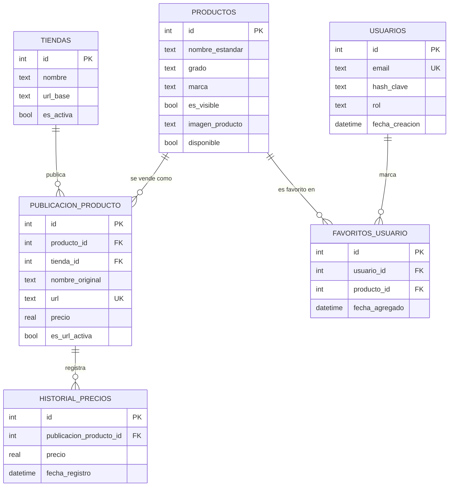

# Base de datos

SQLite en un solo archivo, `precios_comunidad.db` (nombre definido en `config.py`). Las 9 tablas se crean al iniciar la app con `init_db()` en `core/database.py`, solo si no existen. Las claves foráneas están activas en cada conexión (`PRAGMA foreign_keys = ON`).

Diagrama entidad-relación completo: [ER_model.png](ER_model.png).

## Diagrama

Tablas sin relaciones: `banners`, `visitas_mensuales` y `logs`.

## Catálogo

### `productos`

El modelo estandarizado: un mismo kit vendido en varias tiendas es **un solo producto**.

| Columna | Tipo | Descripción |
|---|---|---|
| `id` | INTEGER PK | Autoincremental. |
| `nombre_estandar` | TEXT | Nombre limpio con el grado al final (ej. `GUNDAM EXIA RG`). Es la clave con la que se agrupan las publicaciones. |
| `grado` | TEXT | `PG`, `MG`, `RG`, `HG`, `EG`, `SD`, `FM` o `S/G` (sin grado). |
| `marca` | TEXT | Siempre `Bandai` para los creados por el scraping. |
| `es_visible` | BOOLEAN (1) | Control manual del administrador: Visible u Oculto. |
| `imagen_producto` | TEXT | Ruta de la imagen dentro de `static/` (ej. `productos/45.webp`). Se descarga una vez desde las tiendas o se sube desde el panel; `NULL` mientras no tenga. |
| `disponible` | BOOLEAN (1) | Calculado: `0` cuando ninguna tienda lo tiene activo. Ver [Disponibilidad](#disponibilidad). |

`disponible` se agregó después de la primera versión. `init_db()` la crea con `ALTER TABLE` si falta, sin tocar los datos.

### `tiendas`

| Columna | Tipo | Descripción |
|---|---|---|
| `id` | INTEGER PK | Autoincremental. |
| `nombre` | TEXT | Nombre con que la registra `ScraperManager` (ej. `Hangar019`). Los productos creados a mano desde el panel van a la tienda `Manual`. |
| `url_base` | TEXT | Dominio de la tienda. |
| `es_activa` | BOOLEAN (1) | Sin uso por ahora: las tiendas activas son las que están en `ScraperManager`. |

Las tiendas no se crean a mano: `ScraperManager.guardar_datos()` inserta cada una la primera vez que su scraper devuelve productos.

### `publicacion_producto`

Un producto en una tienda concreta: su enlace y su precio actual.

| Columna | Tipo | Descripción |
|---|---|---|
| `id` | INTEGER PK | Autoincremental. |
| `producto_id` | INTEGER FK → `productos.id` | `NULL` mientras la publicación no se haya vinculado a un producto del catálogo. |
| `tienda_id` | INTEGER FK → `tiendas.id` | |
| `nombre_original` | TEXT | El título tal como lo publica la tienda. |
| `url` | TEXT UNIQUE | Identifica la publicación entre corridas. |
| `precio` | REAL | Último precio visto, en pesos chilenos. |
| `es_url_activa` | BOOLEAN (1) | `1` si apareció en la última corrida del scraper de su tienda. |
| `imagen_url` | TEXT | URL de la imagen en el listado de la tienda. Si una corrida no la trae, se conserva la anterior. |

Borrar un producto o una tienda borra sus publicaciones (`ON DELETE CASCADE`).

### `historial_precios`

| Columna | Tipo | Descripción |
|---|---|---|
| `id` | INTEGER PK | Autoincremental. |
| `publicacion_producto_id` | INTEGER FK → `publicacion_producto.id` | |
| `precio` | REAL | Precio observado. |
| `fecha_registro` | DATETIME | `YYYY-MM-DD HH:MM:SS`, hora local del servidor. |

Cada corrida agrega una fila por publicación encontrada, aunque el precio no haya cambiado. El gráfico de la ficha de producto se arma con esta tabla, y la fecha más reciente es la "Última actualización" que muestra el sitio.

## Usuarios

### `usuarios`

| Columna | Tipo | Descripción |
|---|---|---|
| `id` | INTEGER PK | El administrador es siempre el `id = 1`. |
| `email` | TEXT UNIQUE | Nombre de usuario del panel. |
| `hash_clave` | TEXT | Hash de Werkzeug (`generate_password_hash`), nunca la contraseña. |
| `rol` | TEXT | `user` por defecto; el administrador queda como `admin`. |
| `fecha_creacion` | DATETIME | |

La tabla parte vacía: mientras no haya fila, el panel acepta las credenciales `ADMIN_USER` / `ADMIN_PASS` del `.env`. La fila del administrador se crea la primera vez que se usa **Cambiar credenciales** en el panel.

### `favoritos_usuario`

| Columna | Tipo | Descripción |
|---|---|---|
| `id` | INTEGER PK | |
| `usuario_id` | INTEGER FK → `usuarios.id` | |
| `producto_id` | INTEGER FK → `productos.id` | |
| `fecha_agregado` | DATETIME | |

Preparada para las cuentas de usuario; todavía no se usa.

## Sitio y registro

### `banners`

Imágenes del carrusel de inicio, administradas desde el panel.

| Columna | Tipo | Descripción |
|---|---|---|
| `id` | INTEGER PK | |
| `nombre_archivo` | TEXT | Archivo dentro de `static/carrusel/`. |
| `enlace` | TEXT | Destino al hacer clic. |
| `orden` | INTEGER | Posición en el carrusel. |

### `visitas_mensuales`

| Columna | Tipo | Descripción |
|---|---|---|
| `mes` | TEXT PK | `YYYY-MM`. |
| `contador` | INTEGER | Visitas únicas del mes. |

La página de inicio suma una visita por navegador y por día: deja una cookie `visita_contada` que vence a medianoche.

### `logs`

| Columna | Tipo | Descripción |
|---|---|---|
| `id` | INTEGER PK | |
| `fecha_registro` | DATETIME | |
| `accion` | TEXT | Mensaje del evento. |
| `nivel` | TEXT | `INFO` por defecto; por ahora no se usan otros niveles. |

Se escribe con `registrar_log()` (`core/logger.py`), que además imprime el mensaje en la consola. Registra inicios de sesión, acciones del panel y cada etapa del scraping. El panel muestra los últimos eventos.

## Procesos que modifican los datos

### Disponibilidad

`actualizar_disponibilidad_productos()` corre al final de cada scraping:

- `disponible = 1` si al menos una publicación del producto tiene `es_url_activa = 1`.
- `disponible = 0` si ninguna la tiene. El producto se muestra como "No disponible" y sale del catálogo público.

Es independiente de `es_visible`: si el producto vuelve a estar en stock, recupera el estado Visible u Oculto que tenía.

### Fusión de duplicados

Desde el panel, al fusionar un producto duplicado con uno principal:

1. Todas las publicaciones del duplicado pasan al principal (`UPDATE publicacion_producto SET producto_id = …`), con su historial.
2. Se borra el producto duplicado.

### Respaldo

- La base funciona en **modo WAL**: los cambios recientes pasan un rato por `precios_comunidad.db-wal`. Por eso nunca se copia el archivo directamente; las copias usan la API de respaldo de SQLite (`core/respaldos.py`) y quedan en un solo archivo.
- **Respaldo diario** a las 03:00 en `respaldos/precios_AAAA-MM-DD.db`, conservado 30 días. Después del respaldo se borran los eventos de `logs` con más de 90 días.
- **Respaldo de la base** en el panel descarga una copia completa al momento.
- **Exportar a Excel** genera un `.xlsx` con el historial de precios (hoja "Historial Global").
