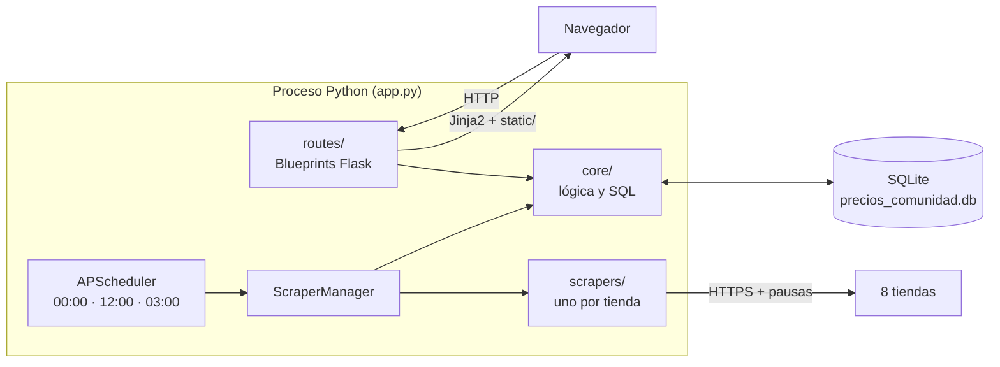
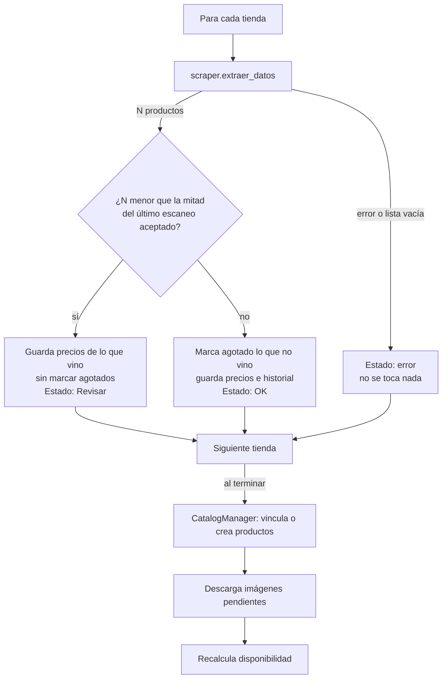
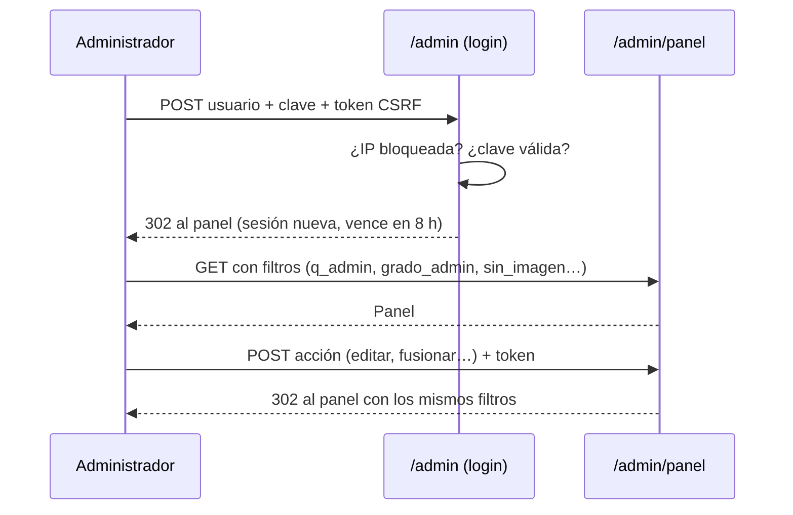
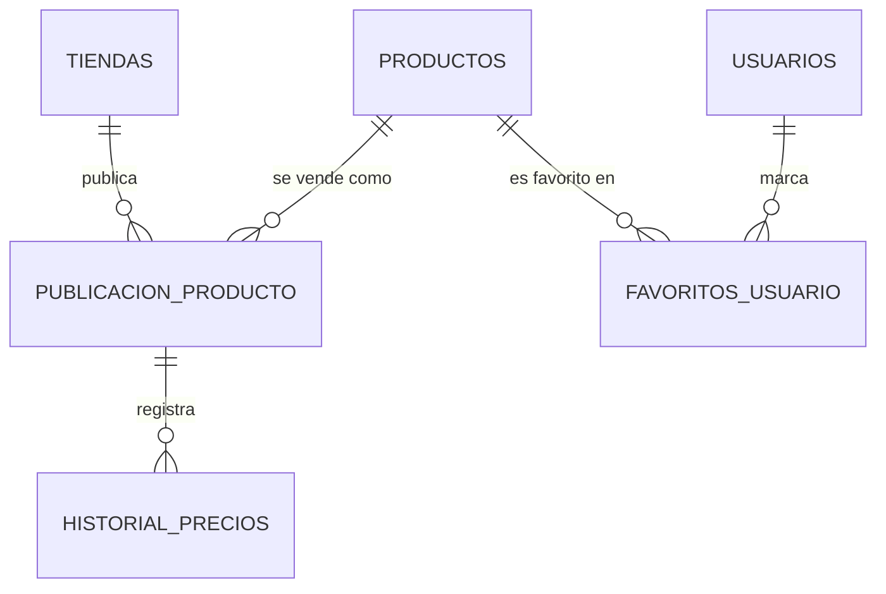

# Manual del desarrollador

**Gunpla Scraper Chile** · radar de precios de Gunpla en tiendas chilenas
Versión del documento: octubre de 2026 · Python 3.11+ · Flask 3.1 · SQLite

Este manual explica cómo está construido el sistema, por qué se tomaron sus decisiones técnicas y cómo trabajar en él con seguridad: instalarlo, entender sus flujos, probarlo, operarlo y extenderlo. Complementa al [README](../README.md), que presenta el producto, y a dos documentos de referencia: [Base de datos](BASE-DE-DATOS.md) y [Scrapers](SCRAPERS.md).

---

## Contenido

1. [Resumen del sistema](#1-resumen-del-sistema)
2. [Arquitectura](#2-arquitectura)
3. [Stack técnico](#3-stack-técnico)
4. [Puesta en marcha](#4-puesta-en-marcha)
5. [Configuración](#5-configuración)
6. [Estructura del código](#6-estructura-del-código)
7. [Flujos principales](#7-flujos-principales)
8. [Modelo de datos](#8-modelo-de-datos)
9. [Rutas HTTP](#9-rutas-http)
10. [Seguridad](#10-seguridad)
11. [Frontend](#11-frontend)
12. [Pruebas](#12-pruebas)
13. [Operación](#13-operación)
14. [Guías de extensión](#14-guías-de-extensión)
15. [Convenciones](#15-convenciones)
16. [Decisiones técnicas](#16-decisiones-técnicas)
17. [Limitaciones conocidas y hoja de ruta](#17-limitaciones-conocidas-y-hoja-de-ruta)
18. [Solución de problemas](#18-solución-de-problemas)

---

## 1. Resumen del sistema

Gunpla Scraper Chile recorre dos veces al día el catálogo de 8 tiendas chilenas, normaliza los nombres de los productos para agrupar las publicaciones de un mismo kit y guarda cada precio observado. Con eso ofrece:

- **Sitio público:** catálogo con filtros, ficha por producto con el mejor precio del día, comparación entre tiendas, historial en gráfico y etiquetas de mínimo histórico y bajas recientes.
- **Panel de administración:** estado de cada tienda, sugerencia y fusión de duplicados, edición del catálogo, imágenes, carrusel, exportación a Excel y respaldo de la base.

Funciona como **un solo proceso** sin servicios externos: Flask sirve el sitio, APScheduler programa los escaneos y los respaldos, y SQLite guarda todo en un archivo. Todo lo que ve el navegador (estilos, fuentes, librerías) se sirve desde el propio sitio.

| Cifra (octubre de 2026) | Valor |
|---|---|
| Tiendas monitoreadas | 8 (PrestaShop, Shopify, Odoo, Magento y WooCommerce) |
| Productos en catálogo | ~430 |
| Pruebas automáticas | 77, en GitHub Actions en cada push |
| Dependencias de Python | 10, con versión fija |

---

## 2. Arquitectura

### 2.1 Vista general



### 2.2 Capas y responsabilidades

El código sigue una separación estricta en tres capas. Es la regla más importante para mantenerlo:

| Capa | Carpeta | Hace | No hace |
|---|---|---|---|
| Presentación | `routes/`, `templates/`, `static/` | Lee parámetros, llama a `core`, elige plantilla o redirección | SQL, reglas de negocio |
| Dominio y datos | `core/` | Reglas del catálogo, consultas SQL, archivos, seguridad | Conocer `request` o plantillas (salvo `seguridad.py`, que integra CSRF con Flask) |
| Extracción | `scrapers/` | Leer el HTML de una tienda y devolver una lista de diccionarios | Escribir en la base, normalizar nombres |

Consecuencias prácticas:

- Un scraper se puede probar sin base de datos (ver [12.3](#123-pruebas-de-scrapers)).
- Toda la lógica del catálogo es probable sin servidor HTTP.
- Las rutas son delgadas: si una ruta crece, la lógica nueva va a `core/`.

### 2.3 Principios de diseño

- **Sin dependencias externas en ejecución:** ni CDN, ni APIs, ni servicios de terceros. La IP de los visitantes no sale del sitio.
- **Integridad antes que frescura:** ante una duda (una tienda que falla, un escaneo incompleto) se conservan los datos anteriores en vez de marcar productos como agotados.
- **Scraping ético:** solo tiendas cuyo `robots.txt` lo permite, con pausas entre páginas y respetando `Retry-After`.
- **Cambios no disruptivos:** las migraciones de la base agregan columnas sin borrar datos, y las URL antiguas redirigen.

---

## 3. Stack técnico

| Área | Tecnología | Versión | Uso |
|---|---|---|---|
| Lenguaje | Python | ≥ 3.11 | Probado en 3.11 y en la última versión estable (CI) |
| Web | Flask + Werkzeug | 3.1.3 / 3.1.9 | Blueprints, sesiones firmadas, hash de contraseñas |
| Servidor | Waitress | 3.0.2 | Servidor WSGI de producción, multiplataforma |
| Plantillas | Jinja2 | (con Flask) | Autoescape activado |
| Base de datos | SQLite | (stdlib) | Modo WAL, claves foráneas activas |
| Scraping | Requests, BeautifulSoup4, cloudscraper | 2.34.2 / 4.15.0 / 1.2.71 | cloudscraper solo para la tienda tras Cloudflare |
| Tareas | APScheduler | 3.11.3 | Trigger `cron` dentro del proceso |
| Imágenes | Pillow | 13.0.0 | Reducción a WebP de 400 px y validación de subidas |
| Reportes | openpyxl | 3.1.5 | Exportación del historial a `.xlsx` |
| Configuración | python-dotenv | 1.2.4 | Lectura del `.env` |
| Interfaz | Bootstrap 5.3.3, Chart.js 4.6.1, IBM Plex | locales | Servidos desde `static/`, sin CDN |
| Pruebas | unittest | (stdlib) | Sin dependencias extra |
| CI | GitHub Actions | | `.github/workflows/pruebas.yml` |

Las versiones están fijadas en `requirements.txt`. Para actualizar una: subir la versión, correr las pruebas y revisar el sitio antes de hacer commit.

---

## 4. Puesta en marcha

### 4.1 Requisitos

- Python 3.11 o superior.
- Git.
- Recomendado: VS Code. El repositorio incluye `.vscode/settings.json`, que activa el entorno virtual en la terminal, y `.vscode/launch.json`, para depurar.

### 4.2 Instalación

```bash
git clone <url-del-repositorio>
cd GundamScrapperChile
python -m venv .venv
.venv\Scripts\python -m pip install -r requirements.txt
```

En Linux o macOS la ruta del intérprete es `.venv/bin/python`.

### 4.3 Variables de entorno

Crear un archivo `.env` en la raíz. Nunca va al repositorio: está en `.gitignore`.

```env
ADMIN_USER=usuario_inicial
ADMIN_PASS=una_contraseña_larga
SECRET_KEY=cadena_aleatoria_de_64_caracteres
```

Para generar una `SECRET_KEY`:

```bash
python -c "import secrets; print(secrets.token_hex(32))"
```

### 4.4 Ejecución

```bash
.venv\Scripts\python app.py
```

- Sitio en `http://127.0.0.1:5000` y panel en `/admin`.
- La base `precios_comunidad.db` se crea al primer inicio, vacía. Se llena con el primer escaneo, programado o lanzado desde **Forzar escaneo** en el panel.
- Waitress **no recarga las plantillas**: después de editar un `.html`, reiniciar el proceso.

### 4.5 Pruebas

```bash
.venv\Scripts\python -m unittest discover tests
```

Las pruebas no usan red ni la base real, así que pueden correr sin `.env`.

---

## 5. Configuración

### 5.1 Variables del `.env`

| Variable | Obligatoria | Por defecto | Descripción |
|---|---|---|---|
| `ADMIN_USER` | Sí | | Usuario del panel mientras no se cambie desde el panel |
| `ADMIN_PASS` | Sí | | Contraseña inicial; desde el panel se guarda como hash |
| `SECRET_KEY` | Sí | | Firma las cookies de sesión. Cambiarla cierra todas las sesiones |
| `HOST` | No | `127.0.0.1` | `0.0.0.0` para aceptar conexiones de la red |
| `PORT` | No | `5000` | Puerto HTTP |
| `HTTPS` | No | apagado | `1` en producción con https: cookies con `Secure`. En local debe quedar apagado |
| `FLASK_DEBUG` | No | apagado | `1` usa el servidor de desarrollo con depurador. **Nunca en producción** |

`validar_configuracion()` (`config.py`) detiene el arranque si falta alguna obligatoria.

### 5.2 Parámetros en el código

Valores de negocio que viven como constantes con nombre, junto al código que los usa:

| Constante | Archivo | Valor | Efecto |
|---|---|---|---|
| `DB_NAME` | `config.py` | `<proyecto>/precios_comunidad.db` | Ruta absoluta: no depende de la carpeta de arranque |
| `DIAS_RESPALDO` | `config.py` | 30 | Días que se conservan los respaldos diarios |
| `HORAS_ALERTA` | `core/estadisticas.py` | 48 | Horas sin escaneo exitoso antes de marcar una tienda para revisar |
| `FRACCION_MINIMA` | `core/scraper_manager.py` | 0,5 | Un escaneo con menos de la mitad de productos se considera incompleto |
| `MINIMO_PARA_COMPARAR` | `core/scraper_manager.py` | 10 | Tiendas más chicas no se comparan |
| `DIAS_TOLERANCIA` | `core/scraper_manager.py` | 7 | Días con aviso antes de aceptar una caída de catálogo como real |
| `DIAS_BAJA` | `core/catalogo.py` | 7 | Ventana de la etiqueta "↓ X %" |
| `POR_PAGINA_PERMITIDOS` | `core/catalogo.py` | 24, 48, 120 | Tamaños de página del catálogo |
| `MAX_INTENTOS`, `BLOQUEO_SEGUNDOS` | `routes/admin/admin_login.py` | 5, 900 | Bloqueo del login por intentos fallidos |
| `PERMANENT_SESSION_LIFETIME` | `app.py` | 8 h | Vencimiento de la sesión sin actividad |
| `ANCHO_MAXIMO`, `CALIDAD_WEBP`, `BYTES_MAXIMOS` | `core/imagenes.py` | 400 px, 80, 5 MB | Tratamiento de imágenes de productos |
| `REINTENTABLES`, `ESPERA_MAXIMA` | `core/peticiones.py` | 429 y 5xx, 60 s | Política de reintentos ante las tiendas |

---

## 6. Estructura del código

```
app.py                     Punto de entrada: crea la app, registra blueprints, errores, caché y scheduler
config.py                  Rutas y variables del .env
core/
├── database.py            Conexión, transacciones, creación de tablas, migraciones y modo WAL
├── catalogo.py            Listados (inicio y panel), ficha de producto, mínimo histórico y bajas
├── productos.py           Editar, ocultar, eliminar, fusionar y crear productos
├── duplicados.py          Sugerencia de posibles duplicados y pares descartados
├── catalog_manager.py     Normalización de nombres, grado y palabras bloqueadas
├── scraper_manager.py     Orquestador del escaneo: guardado, protección y estado por tienda
├── peticiones.py          GET a las tiendas con reintentos (429, 5xx, cortes)
├── imagenes.py            URL desde el listado, descarga única, WebP y subidas del panel
├── carrusel.py            Imágenes del carrusel del inicio
├── estadisticas.py        Estado de tiendas y resumen del panel
├── exportar.py            Historial en Excel (openpyxl)
├── respaldos.py           Respaldo diario y copia en memoria para descargar
├── seguridad.py           CSRF y cabeceras de seguridad (CSP)
├── usuarios.py            Credenciales del administrador
├── precios.py             Texto de precio → número
└── logger.py              Registro de eventos y limpieza de antiguos
routes/
├── public/views_inicio.py         Inicio, ficha de producto, sitemap.xml y robots.txt
├── public/views_institucional.py  Sobre el proyecto, FAQ, condiciones y privacidad
├── admin/admin_login.py           Acceso con límite de intentos
└── admin/admin.py                 Panel y sus acciones
scrapers/                  Un módulo por tienda, con el mismo contrato (ver SCRAPERS.md)
templates/
├── base.html              Esqueleto común: cabecera, tema, banner, pie
├── public/                Páginas públicas, error 404/500 y macros (_mascota, _sin_imagen)
└── admin/                 Login, panel (secciones en panel/) y edición
static/
├── css/tema.css           Tema propio sobre Bootstrap (variables, claro/oscuro)
├── js/                    Un archivo por página y los de carga temprana (tema, banner)
├── vendor/, js/vendor/    Bootstrap y Chart.js locales
├── fonts/                 IBM Plex (con licencias OFL)
├── productos/             Imágenes descargadas (fuera de git, se regeneran)
└── carrusel/              Imágenes subidas desde el panel
tests/                     Pruebas unittest, páginas reales de tiendas y resultados de referencia
docs/                      Este manual, base de datos, scrapers, diagrama ER y capturas
```

---

## 7. Flujos principales

### 7.1 Ciclo de escaneo

Lo lanza APScheduler a las 00:00 y 12:00 (`ejecutar_todos`) o el botón **Forzar escaneo** (`iniciar_en_segundo_plano`). Un candado (`threading.Lock`) impide dos escaneos simultáneos.



Garantías del flujo:

- **Atomicidad por tienda:** el guardado de una tienda ocurre en una sola transacción. Si algo falla a mitad, se revierte completo.
- **Sin listas parciales:** un scraper que falla en la página N relanza el error en vez de devolver lo leído. Así no se marcan agotados los productos de las páginas que faltaron.
- **Escaneo incompleto:** si una tienda cambia su HTML y el scraper encuentra muchos menos productos, el stock se conserva y el panel muestra el motivo. Si el aviso dura 7 días, la cantidad nueva se acepta como real.
- **Reintentos:** `pedir()` reintenta ante 429, 5xx y cortes, respetando `Retry-After` hasta 60 s.

El detalle de la normalización y el contrato de cada scraper están en [SCRAPERS.md](SCRAPERS.md).

### 7.2 Catálogo público

`GET /` → `views_inicio.index`:

1. Valida los parámetros (`q`, `grado`, `sort`, `page`, `per_page`). El orden se elige de una lista cerrada y el tamaño de página de `POR_PAGINA_PERMITIDOS`.
2. Cuenta una visita por navegador y día con la cookie `visita_contada` (`HttpOnly`, `SameSite=Lax`). No guarda datos personales.
3. `catalogo.listar_catalogo_publico` devuelve la página pedida. El precio mostrado es el más bajo entre las tiendas **con stock hoy**.
4. `catalogo.indicadores_precio` calcula, en una sola consulta para toda la página, el mínimo histórico y la baja de los últimos 7 días.

### 7.3 Ficha de producto

`GET /producto/<id>-<slug>`:

- Si el slug no coincide con el nombre actual, redirige con **301** a la URL correcta, conservando los filtros. Así una URL vieja o sin nombre nunca da error.
- `catalogo.detalle_producto` arma las tiendas (con stock primero), el resumen de precios y las series del gráfico. Cada tienda repite su último precio conocido en los días sin escaneo.
- Los datos del gráfico van en `<script type="application/json">`, que el navegador no ejecuta y por eso son compatibles con la CSP. `producto.js` los lee y dibuja con Chart.js.
- Incluye metadatos Open Graph y Twitter con la foto y el precio, para compartir.

### 7.4 Panel de administración



- Todas las rutas del panel usan el decorador `login_required`.
- Toda acción que modifica datos es POST y lleva el token CSRF. El escaneo forzado lo envía en la cabecera `X-CSRF-Token`.
- Los filtros del listado (`FILTROS_PANEL`) viajan en cada acción y `volver_al_panel()` los restaura, así el administrador no pierde su lugar.

---

## 8. Modelo de datos

Nueve tablas en SQLite. El detalle de columnas y procesos está en [BASE-DE-DATOS.md](BASE-DE-DATOS.md) y el diagrama completo en [ER_model.png](ER_model.png).



Conceptos clave:

- **Producto:** el kit estandarizado, por ejemplo `GUNDAM EXIA RG`. Tiene dos estados independientes: `es_visible`, que decide el administrador, y `disponible`, que se calcula según el stock.
- **Publicación:** ese kit en una tienda, identificada por su URL. `es_url_activa` indica si apareció en el último escaneo.
- **Historial:** una fila por publicación y escaneo, con precio y fecha.

Prácticas de la capa de datos:

- **Consultas siempre parametrizadas** (`?`). Las partes dinámicas, como el orden, se eligen de listas cerradas en el código.
- **Transacciones explícitas** con `transaccion()` cuando varias escrituras deben aplicarse juntas (guardado de un escaneo, fusión, eliminación).
- **Migraciones no disruptivas:** `init_db()` crea lo que falta y agrega columnas nuevas con `ALTER TABLE ... ADD COLUMN` si no existen. Nunca borra datos.
- **Modo WAL:** el sitio lee mientras un escaneo escribe. Los cambios recientes viven un rato en `precios_comunidad.db-wal`, así que la base **nunca se copia como archivo**: se usa `core/respaldos.py`, que lo hace con la API de respaldo de SQLite.

---

## 9. Rutas HTTP

### Públicas

| Método | Ruta | Descripción |
|---|---|---|
| GET | `/` | Inicio y catálogo (`q`, `grado`, `sort`, `page`, `per_page`) |
| GET | `/producto/<id>` | Redirige (301) a la URL con nombre |
| GET | `/producto/<id>-<slug>` | Ficha del producto |
| GET | `/sobre-nosotros`, `/faq`, `/condiciones-de-servicio`, `/politicas` | Páginas institucionales |
| GET | `/sitemap.xml` | Productos visibles, para buscadores |
| GET | `/robots.txt` | Excluye `/admin` e indica el sitemap |

### Panel (requieren sesión; los POST requieren token CSRF)

| Método | Ruta | Descripción |
|---|---|---|
| GET, POST | `/admin` | Acceso (público); bloqueo de 15 min tras 5 intentos fallidos por IP |
| GET | `/admin/panel` | Panel completo (`q_admin`, `grado_admin`, `sort_admin`, `page`, `per_page`, `sin_imagen`) |
| POST | `/admin/force-update` | Lanza un escaneo en segundo plano |
| GET | `/admin/force-update/estado` | Estado del escaneo en curso (JSON) |
| GET | `/admin/backup` | Descarga una copia consistente de la base |
| GET | `/admin/exportar_excel` | Historial completo en `.xlsx` |
| POST | `/admin/producto/nuevo` | Crea un producto manual con su publicación |
| GET, POST | `/admin/producto/editar/<id>` | Nombre, grado e imagen |
| POST | `/admin/producto/toggle/<id>` | Ocultar o mostrar |
| POST | `/admin/producto/eliminar/<id>` | Elimina el producto, su historial y su imagen |
| POST | `/admin/fusionar` | Pasa publicaciones e historial de un duplicado al principal |
| POST | `/admin/duplicados/descartar` | Marca un par sugerido como distinto |
| POST | `/admin/carrusel/nuevo` | Sube una imagen al carrusel |
| POST | `/admin/carrusel/editar_link/<id>` | Cambia el enlace de una imagen |
| POST | `/admin/carrusel/eliminar/<id>` | Quita una imagen |
| POST | `/admin/credenciales/actualizar` | Cambia usuario y contraseña (hash de Werkzeug) |
| POST | `/admin/logout` | Cierra la sesión |

Errores: 404 y 500 usan `templates/public/error.html`. La página 500 nunca muestra detalles técnicos al visitante.

---

## 10. Seguridad

Modelo de amenazas resumido: un sitio público de solo lectura con un único administrador. Los riesgos principales son el acceso indebido al panel, la manipulación de datos mediante solicitudes forjadas y la inyección de contenido.

| Riesgo | Control | Dónde |
|---|---|---|
| Inyección SQL | Parámetros `?` en todas las consultas; orden y filtros desde listas cerradas | `core/` |
| CSRF | Token por sesión en cada POST (formulario o cabecera), comparado en tiempo constante; cookie `SameSite=Lax` | `core/seguridad.py` |
| XSS | Autoescape de Jinja2; CSP sin `unsafe-inline`; sin scripts ni manejadores `on…` en las plantillas | `core/seguridad.py`, `templates/` |
| Clickjacking | `frame-ancestors 'none'` | CSP |
| Fuerza bruta | Bloqueo de 15 min por IP tras 5 intentos | `admin_login.py` |
| Robo o fijación de sesión | Sesión nueva al entrar, vencimiento a las 8 h, `HttpOnly`, `Secure` con `HTTPS=1` | `app.py`, `admin_login.py` |
| Contraseñas | Hash de Werkzeug al cambiarlas; las iniciales solo en `.env` | `core/usuarios.py` |
| Subidas maliciosas | Lista de extensiones; las imágenes de productos se re-codifican con Pillow, que descarta lo que no es imagen | `core/imagenes.py`, `core/carrusel.py` |
| Descargas desde HTML ajeno | Solo `http(s)`, tiempo límite y tamaño máximo | `core/imagenes.py` |
| Fuga de información | Debug apagado por defecto; páginas de error genéricas | `config.py`, `app.py` |
| Secretos en el repositorio | `.env`, base y respaldos en `.gitignore` | `.gitignore` |

Cabeceras en todas las respuestas:

```
Content-Security-Policy: default-src 'self'; img-src 'self' data:; object-src 'none';
                         frame-ancestors 'none'; base-uri 'self'; form-action 'self'
X-Content-Type-Options: nosniff
Referrer-Policy: strict-origin-when-cross-origin
```

Reglas para no romper estas garantías:

- **Nunca** construir SQL con f-strings que incluyan datos del usuario.
- **Nunca** escribir `<script>` en línea, `onclick=` ni `style="..."` en las plantillas. La CSP los bloquea y `tests/test_seguridad.py` lo verifica. El código va en `static/js/` y los estilos en `tema.css`.
- Toda acción nueva del panel: `login_required`, método POST y `{{ campo_csrf() }}` en el formulario.

---

## 11. Frontend

### 11.1 Plantillas

`templates/base.html` define el esqueleto y estos bloques, que cada página sobrescribe:

| Bloque | Uso |
|---|---|
| `title` | Título de la pestaña |
| `compartir` | Metadatos Open Graph y Twitter (la ficha pone foto y precio) |
| `extra_head` | Estilos o metadatos de una página |
| `cabecera`, `banner`, `pie` | Partes comunes; el panel las reemplaza |
| `alertas` | Mensajes sobre el contenido |
| `principal` / `content` | Contenido de la página |
| `scripts` | JS propio de la página |

Macros reutilizables: `public/_mascota.html` (mascota según el tema) y `public/_sin_imagen.html` (reemplazo para productos sin foto). Filtros de Jinja: `fecha` (`HH:MM dd/mm/aaaa`) y `slug`.

### 11.2 Estilos y tema

- `static/css/tema.css` es la única hoja propia. Define variables (`--acento`, `--superficie`, `--texto`…) y redefine las del tema oscuro bajo `:root[data-theme="dark"]`. Bootstrap recibe el tema por `data-bs-theme`.
- Colores de marca tomados del banner: dorado `#C29045` y negro.
- El tema y la vista del catálogo se aplican antes de dibujar la página (`static/js/tema-inicial.js`, en el `<head>`), así no hay parpadeo.

### 11.3 JavaScript

Sin frameworks ni compilación: un archivo por responsabilidad.

| Archivo | Responsabilidad |
|---|---|
| `tema-inicial.js` | Tema y vista guardados, antes de dibujar |
| `banner-inicial.js` | Banner del tema correcto |
| `main.js` | Cambio de tema y confirmaciones (`data-confirmar`) |
| `inicio.js` | Vista cuadrícula o lista |
| `producto.js` | Gráfico del historial y "copiar enlace" |
| `admin.js` | Ventana de fusión, envío automático de filtros y estado del escaneo forzado |

### 11.4 Caché de archivos estáticos

`url_for('static', ...)` agrega `?v=<fecha de modificación>` automáticamente (`app.py`), y esas URL se sirven con `Cache-Control: max-age` de un año. Al modificar un archivo cambia su URL y el navegador descarga la versión nueva sin intervención. Las fuentes van sin versión, porque `tema.css` las pide por ruta fija, y también se guardan un año.

### 11.5 Accesibilidad

Enlace "Saltar al contenido", textos alternativos, `aria-label` en los botones con solo icono, `aria-pressed` en los selectores, gráfico con `role="img"` y descripción, objetivos táctiles de al menos 44 px en el panel y diseño adaptado a celular, sin desplazamiento horizontal.

---

## 12. Pruebas

### 12.1 Estrategia

- **Aisladas:** cada prueba usa una base SQLite temporal (`BaseTemporal`) y nunca toca `precios_comunidad.db`.
- **Sin red:** las peticiones a las tiendas se simulan con `unittest.mock`.
- **Pruebas de regresión antes que unitarias:** se prueban comportamientos visibles, como "un escaneo incompleto no deja productos sin stock", más que funciones internas.
- **Referencias guardadas:** dos archivos fijan el resultado esperado de partes completas del sistema.

### 12.2 Archivos

| Archivo | Cubre |
|---|---|
| `test_regresiones.py` | Normalización, fusión, duplicados, panel, transacciones, reintentos, paginación, estado de tiendas, respaldos, WAL, eventos, descarga de la base |
| `test_listados.py` | Resultado completo de inicio, ficha, panel y Excel contra `listados_esperados.json` |
| `test_scrapers.py` | Los 8 scrapers sobre páginas reales guardadas en `tests/paginas/` |
| `test_escaneo_incompleto.py` | Protección ante caídas bruscas de productos |
| `test_indicadores.py` | Mínimo histórico y porcentaje de baja |
| `test_imagenes.py` | Lectura de URL de imagen, WebP, descarga única, subidas y filtro "Sin imagen" |
| `test_login.py` | Bloqueo por intentos, sesión nueva y cierre de sesión por POST |
| `test_seguridad.py` | Cabeceras, CSP, plantillas sin código en línea, caché y páginas de error |
| `test_seo.py` | Slugs, fechas, metadatos para compartir, sitemap y robots |

### 12.3 Pruebas de scrapers

`tests/paginas/` guarda la primera página real de cada tienda, recortada a los bloques de producto que lee su scraper. Incluye productos que el scraper debe descartar (agotados, otras marcas), así que la prueba también cubre esos filtros. `esperados.json` tiene lo que cada scraper obtuvo de la página completa el día que se guardó.

Si una tienda cambia su HTML, el panel la marca como **Revisar**. Se corrige el scraper y se reemplazan su página y su entrada en `esperados.json`.

### 12.4 Comandos

```bash
# Todo
.venv\Scripts\python -m unittest discover tests

# Un archivo, una clase o una prueba
.venv\Scripts\python -m unittest tests.test_login
.venv\Scripts\python -m unittest tests.test_regresiones.TestFusion

```

Para regenerar la referencia de listados después de un cambio intencional, en PowerShell (y revisar el diff antes del commit):

```powershell
$env:REGENERAR_LISTADOS=1; .venv\Scripts\python -m unittest tests.test_listados; Remove-Item Env:REGENERAR_LISTADOS
```

### 12.5 Integración continua

`.github/workflows/pruebas.yml` corre todas las pruebas en cada push y pull request, con Python 3.11 (la mínima) y con la última versión estable.

---

## 13. Operación

### 13.1 Tareas programadas

| Hora | Tarea | Función |
|---|---|---|
| 00:00 y 12:00 | Escaneo completo | `ScraperManager.ejecutar_todos` |
| 03:00 | Respaldo de la base y limpieza de eventos de más de 90 días | `respaldar_base` |

El scheduler arranca solo con `python app.py`. Importar `app` (pruebas, otro servidor WSGI) no lo inicia; en ese caso hay que llamar a `iniciar_scheduler()` en **un único** proceso.

### 13.2 Monitoreo

El panel es la consola de operación:

- **Alerta general** si el último escaneo exitoso tiene más de 48 horas.
- **Estado de las tiendas:** último éxito, productos y último error. "Revisar" indica un fallo o un escaneo incompleto, con el motivo.
- **Eventos recientes:** cada escaneo, acción del panel, inicio de sesión (exitoso o fallido) y respaldo queda en la tabla `logs`.

### 13.3 Respaldos y restauración

- Copias diarias en `respaldos/precios_AAAA-MM-DD.db`, conservadas 30 días. Cada copia es un único archivo consistente.
- Desde el panel, **Respaldo de la base** descarga una copia al momento.

Para restaurar:

1. Detener la app.
2. Mover `precios_comunidad.db`, `-wal` y `-shm` a otra carpeta, por si se necesitan.
3. Copiar el respaldo elegido como `precios_comunidad.db`.
4. Iniciar la app. `init_db()` aplica cualquier migración pendiente.

### 13.4 Publicación

Lista mínima para publicar el sitio:

- `HTTPS=1`, `FLASK_DEBUG` apagado y una `SECRET_KEY` propia del servidor.
- Un solo proceso de la app, para que haya un solo scheduler.
- Si va detrás de un proxy inverso (Nginx, Cloudflare), aplicar `ProxyFix` para que el límite de intentos del login vea la IP real del visitante.
- Respaldos copiados fuera del servidor.

---

## 14. Guías de extensión

### 14.1 Agregar una tienda

Resumen; el detalle está en [SCRAPERS.md](SCRAPERS.md#agregar-una-tienda).

1. Verificar su `robots.txt`.
2. Crear `scrapers/<tienda>.py` a partir de un scraper de la misma plataforma.
3. Registrarlo en `ScraperManager.__init__`.
4. Guardar su primera página en `tests/paginas/<tienda>.html`, agregar lo esperado a `esperados.json` y agregar la tienda a `SCRAPERS` en `test_scrapers.py`.
5. Forzar un escaneo y revisar los eventos y los posibles duplicados.

### 14.2 Agregar una página pública

1. Crear la plantilla en `templates/public/` extendiendo `base.html`.
2. Agregar la ruta en el blueprint que corresponda (`views_institucional.py` para contenido fijo).
3. Si debe aparecer en el menú o el pie, enlazarla en `base.html` con `url_for`.

### 14.3 Agregar una acción al panel

1. Lógica y SQL en `core/` (si escribe en varias tablas, dentro de `transaccion()`).
2. Ruta POST en `routes/admin/admin.py` con `@login_required`, que termine en `volver_al_panel(request.form)`.
3. Formulario con `{{ campo_csrf() }}`. Si pide confirmación, agregar `data-confirmar="¿…?"`.
4. Prueba en `test_regresiones.py` usando `PanelTemporal`.

### 14.4 Cambiar el esquema de la base

1. En `init_db()`, crear la tabla con `CREATE TABLE IF NOT EXISTS` o agregar la columna después de revisar `PRAGMA table_info`, siguiendo el patrón existente.
2. Nunca renombrar ni borrar columnas con datos sin un plan de migración.
3. Actualizar [BASE-DE-DATOS.md](BASE-DE-DATOS.md) y el diagrama.

---

## 15. Convenciones

- **Idioma:** código, comentarios, mensajes y documentación en español, con nombres descriptivos (`listar_catalogo_publico`, `escaneo_incompleto`). Los nombres impuestos por librerías quedan en inglés.
- **Comentarios:** explican el porqué y no repiten el qué. Cada módulo y función pública tiene un docstring con lo que retorna.
- **Constantes con nombre** para todo valor de negocio (ver [5.2](#52-parámetros-en-el-código)).
- **Errores:** los scrapers relanzan; el orquestador captura por tienda y registra. Nunca se silencia un error que pueda dejar datos inconsistentes.
- **Frontend:** sin código en línea; estilos con las variables de `tema.css`; textos de interfaz en español de Chile.
- **Commits:** mensaje en español, en presente y describiendo el efecto ("Escaneos incompletos ya no dejan productos sin stock por error"). Las pruebas deben pasar antes de cada commit.
- **Dependencias:** solo si ahorran código real. Antes de agregar una, revisar la biblioteca estándar y las ya instaladas.

---

## 16. Decisiones técnicas

| Decisión | Alternativa descartada | Motivo |
|---|---|---|
| SQLite | PostgreSQL | Un archivo, sin servidor, respaldo trivial; el volumen (miles de filas por mes) está lejos de sus límites |
| Modo WAL | Journal clásico | Lecturas del sitio sin esperar a las escrituras del escaneo |
| APScheduler en el proceso | Cron del sistema, Celery | Un solo proceso que instalar y operar; el candado evita escaneos simultáneos |
| Waitress | Gunicorn | Funciona igual en Windows y Linux |
| Recursos locales (Bootstrap, fuentes, Chart.js) | CDN | Privacidad de los visitantes y CSP estricta |
| Requests + BeautifulSoup | Selenium, Playwright | Las tiendas entregan HTML en el servidor; mucho más liviano y rápido |
| Normalización por reglas + sugerencia de duplicados | Coincidencia difusa automática | Una fusión equivocada mezcla historiales; se prefiere que el administrador confirme |
| Imágenes en WebP de 400 px, descargadas una vez | Enlazar las de la tienda | No depender de sus servidores ni cargarlos en cada visita |
| openpyxl directo | pandas | Una dependencia de ~50 MB para escribir una planilla |
| unittest | pytest | Cero dependencias de prueba |

---

## 17. Limitaciones conocidas y hoja de ruta

**Limitaciones actuales:**

- El scraping solo ocurre mientras la app está encendida; todavía no hay un servidor de producción definido.
- El límite de intentos del login vive en memoria: se reinicia con el proceso y, detrás de un proxy, requiere `ProxyFix`.
- Las subidas del panel no tienen un tamaño máximo explícito (`MAX_CONTENT_LENGTH`); el riesgo es bajo porque solo el administrador puede subir archivos.
- La agrupación de productos exige nombres normalizados idénticos; las variantes se resuelven con la sugerencia de duplicados o con correcciones manuales.
- Un solo administrador.

**Hoja de ruta:**

- Cuentas de usuario y favoritos (las tablas `usuarios` y `favoritos_usuario` ya existen).
- Publicación en un servidor siempre encendido, con acceso privado.
- Tamaño máximo de subidas.

---

## 18. Solución de problemas

| Síntoma | Causa probable | Solución |
|---|---|---|
| La app no arranca: "Faltan variables en el .env" | `.env` ausente o incompleto | Crear las tres variables obligatorias ([4.3](#43-variables-de-entorno)) |
| No se puede iniciar sesión en local | `HTTPS=1` con el sitio en http: la cookie no se envía | Quitar `HTTPS` del `.env` en local |
| "Demasiados intentos fallidos" | 5 claves incorrectas desde esa IP | Esperar 15 minutos o reiniciar la app |
| Un cambio en una plantilla no se ve | Waitress no recarga plantillas | Reiniciar la app |
| Un cambio en CSS o JS no se ve | Caché del navegador con una URL sin versión | Usar siempre `url_for('static', ...)`; nunca escribir rutas `/static/` a mano en las plantillas |
| Una tienda aparece en "Revisar" | Falló o trajo menos de la mitad de productos | Leer el motivo en el panel; probar el scraper solo ([SCRAPERS.md](SCRAPERS.md#agregar-una-tienda)) y comparar con `tests/paginas/` |
| Alerta de más de 48 horas sin escaneo | La app estuvo apagada o todas las tiendas fallaron | Revisar los eventos y forzar un escaneo |
| Aparecen `precios_comunidad.db-wal` y `-shm` | Funcionamiento normal del modo WAL | No borrarlos con la app encendida; están en `.gitignore` |
| Un botón deja de funcionar y la consola habla de CSP | Código JS en línea en una plantilla | Moverlo a `static/js/` y usar `addEventListener` |
| `test_listados` falla tras un cambio intencional | La referencia guardada quedó desactualizada | Regenerarla ([12.4](#124-comandos)) y revisar el diff |
