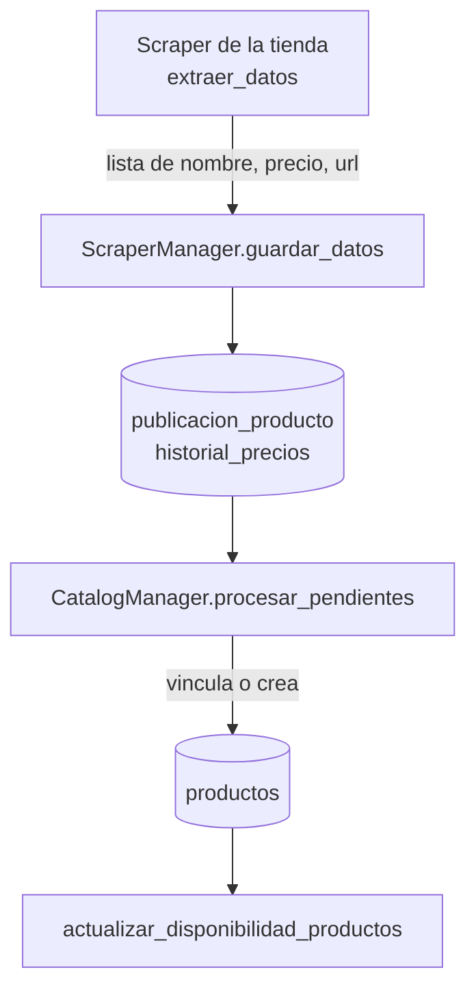

# Scrapers

Cómo se recolectan los precios, cómo se convierten en el catálogo y cómo agregar una tienda nueva.

## Flujo de una corrida

`ScraperManager` (`core/scraper_manager.py`) hace una corrida completa. La lanza APScheduler a las 00:00 y 12:00 (`ejecutar_todos()`), o el botón **Forzar Escaneo** del panel, que la corre en segundo plano (`iniciar_en_segundo_plano()`) mientras el panel consulta `/admin/force-update/estado` hasta que termina. Un candado impide que corran dos a la vez: si ya hay una en curso, la nueva se omite.



1. **Recolección:** cada scraper recorre el catálogo de su tienda y devuelve la lista de productos. Las tiendas se recorren una tras otra; si una falla, se registra el error y se sigue con la siguiente.
2. **Guardado** (`guardar_datos`), por tienda:
   - Registra la tienda en `tiendas` si es la primera vez.
   - Marca **todas** sus publicaciones como inactivas (`es_url_activa = 0`).
   - Por cada producto devuelto, busca la publicación por su `url`. Si existe, la reactiva y actualiza precio y título; si no, la crea sin producto asignado (`producto_id = NULL`).
   - Agrega una fila a `historial_precios` por cada producto devuelto.
   - Las publicaciones que no aparecieron en la corrida quedan inactivas: agotadas o retiradas.
3. **Catálogo** (`CatalogManager.procesar_pendientes`): vincula cada publicación nueva con su producto. Ver [Normalización](#normalización-del-catálogo).
4. **Imágenes:** descarga la imagen de cada producto que aún no tiene, desde la primera de sus publicaciones que traiga `imagen_url` (`core/imagenes.py`). Pausa de 1 s entre descargas; un producto con imagen, descargada o subida desde el panel, no se vuelve a tocar.
5. **Disponibilidad:** recalcula `productos.disponible` (ver [BASE-DE-DATOS.md](BASE-DE-DATOS.md#disponibilidad)).

Si un scraper falla o no devuelve nada, `guardar_datos` no se llama y las publicaciones de esa tienda conservan el estado anterior: una tienda caída, o que falla a mitad de la paginación, no deja productos marcados como agotados por error.

Cada etapa queda en la tabla `logs` y se ve en el panel.

## Contrato de un scraper

Cada tienda es una clase en `scrapers/<tienda>.py` con un solo método público:

```python
class MiTiendaScraper:
    def extraer_datos(self):
        return [
            {"nombre_original": "RG 1/144 Gundam Exia - Bandai", "precio": 34990.0, "url": "https://..."},
            ...
        ]
```

| Campo | Tipo | Notas |
|---|---|---|
| `nombre_original` | str | El título tal como lo publica la tienda. La limpieza la hace `CatalogManager`, no el scraper. |
| `precio` | float | Pesos chilenos, sin puntos ni símbolo. Se convierte con `limpiar_precio()` de `core/precios.py` (compartida con el panel), que junta los dígitos del texto: pasarle solo el precio vigente, no un texto con precio anterior y oferta. |
| `url` | str | Enlace absoluto a la ficha. Debe ser estable: es lo que identifica la publicación entre corridas. |
| `imagen` | str o None | URL de la imagen en la tarjeta del listado: `url_imagen(tarjeta, self.base_url)`. Entiende `data-src`, `srcset`, rutas relativas y `//`. Opcional. |

Reglas que siguen todos:

- **Solo productos en stock.** Lo que no se devuelve queda inactivo. Si la tienda lista agotados, el scraper debe filtrarlos (Geekz mira la etiqueta de stock, Weplay descarta los "Disponible solo en tienda", Blaster filtra por disponibilidad en la URL).
- **Pausa entre páginas** con `time.sleep` (2 segundos en la mayoría; entre 3,5 y 7 al azar en Blaster).
- **Fin de la paginación:** cuando una página no trae productos, o cuando vuelve a aparecer una URL ya vista (algunas tiendas repiten la última página en vez de devolver una vacía).
- **Errores:** se registran con `registrar_log` y se **relanzan**. Nunca se devuelve una lista parcial, porque `ScraperManager` marcaría como agotado todo lo que faltó por leer. Una respuesta HTTP con error también cuenta como fallo (`res.raise_for_status()`), salvo un 404 después de la primera página, que algunas tiendas usan para indicar que no hay más páginas.

## Tiendas

| Tienda | Archivo | Plataforma | Catálogo que recorre | Particularidades |
|---|---|---|---|---|
| Hangar019 | `hangar.py` | PrestaShop | `/8-gunpla?p=N` | |
| Blaster Chile | `blaster.py` | Shopify | `/collections/model-kit`, filtrado por tipo Gundam, Bandai y disponibilidad | Usa `cloudscraper` (Cloudflare). Reintenta ante error 429 con espera creciente. |
| ChileRobots | `chilerobots.py` | PrestaShop | `/10-gundam?page=N` | Si el nombre visible viene truncado (`...`), lo reconstruye desde la URL (`reconstruir_nombre_desde_url`). |
| Irion | `irion.py` | Shopify | `/collections/gundam?page=N` | |
| Geekz | `geekz.py` | Odoo | `/shop/category/hobby-model-kit-9/page/N` | Descarta los productos sin la etiqueta verde de stock. |
| Weplay | `weplay.py` | Magento | `/figuras-y-juguetes/model-kits.html`, marca Bandai, `&p=N` | Descarta los "Disponible solo en tienda". |
| LuffyToys | `luffytoys.py` | Shopify | `/collections/maqueta-armables/gundam?page=N` | |
| HobbyToys | `hobbytoys.py` | WooCommerce | `/categoria-producto/model-kit/gundam-modelkit/page/N/` | |

Tiendas evaluadas y descartadas por su `robots.txt`: Mirax, Top8, Bluecard y Wargaming.

## Normalización del catálogo

`CatalogManager` (`core/catalog_manager.py`) convierte cada `nombre_original` en un `nombre_estandar`. Las publicaciones con el mismo `nombre_estandar` quedan agrupadas en un solo producto.

Por cada publicación sin producto:

1. **Palabras bloqueadas:** si el nombre contiene alguna (`POKEMON`, `NARUTO`, `30MS`, `DECAL`, `ONE PIECE`…), la publicación se **borra** junto con su historial. La comparación ignora mayúsculas y tildes.
2. **Normalización** (`normalizar_nombre`):
   1. Pasa a mayúsculas y aplica las **correcciones** manuales (nombres que las tiendas escriben en otro orden).
   2. Detecta el **grado** con expresiones regulares (`HGUC`, `HGCE`, `HIGH GRADE` → `HG`; `MGEX` → `MG`; etc.) y lo quita del texto. Sin coincidencia, queda `S/G`.
   3. Quita el **ruido**: escalas (`1/144`), `BANDAI`, `NAMCO`, `MODEL KIT`, `FIGURA`, `ARTICULADO`…
   4. Deja solo letras, números y guiones internos (conserva códigos como `MSM-07S`).
   5. Arma `<nombre> <grado>`.
3. **Vinculación:** busca un producto con ese `nombre_estandar` exacto. Si existe, le asigna la publicación; si no, crea el producto.

Ejemplo: `RG 1/144 Gundam Exia - Model Kit Articulado - Bandai` → `GUNDAM EXIA RG`.

La coincidencia es exacta. Si dos tiendas escriben el mismo kit de forma distinta (`Gundam Kyrios` y `Kyrios Gundam`), aparecen dos productos. Hay dos formas de arreglarlo:

- **Una vez:** fusionarlos desde el panel. La sección **Posibles Duplicados** (`core/duplicados.py`) los sugiere: compara productos del mismo grado sin importar el orden de las palabras, los guiones ni "GUNDAM", "VER", "UNIT" o "TYPE", y exige que coincidan exactos los tokens con números o de hasta 2 letras (F91, AGE-3, X frente a ZZ). Los pares marcados como "No son el mismo" no se vuelven a sugerir.
- **Para siempre:** agregar una entrada a `self.correcciones` para que las próximas publicaciones se normalicen igual.

Las listas `correcciones`, `grados_regex`, `ruido` y `palabras_bloqueadas` están al inicio de `CatalogManager.__init__`, y se editan ahí.

## Agregar una tienda

1. **Revisar su `robots.txt`.** Si prohíbe la sección del catálogo o el acceso automatizado, la tienda no se integra.
2. **Copiar el scraper de una tienda con la misma plataforma** (ver la tabla de arriba) a `scrapers/<tienda>.py` y ajustar la URL del catálogo, los selectores de nombre, precio y enlace, y el filtro de stock.
3. **Probarlo solo**, desde la raíz del proyecto:

   ```bash
   python -c "from scrapers.mitienda import MiTiendaScraper; d = MiTiendaScraper().extraer_datos(); print(len(d)); print(d[:3])"
   ```

   Revisar que los precios sean números sin puntos, que las URL sean absolutas y que no falten productos de la última página.
4. **Registrarlo** en `ScraperManager.__init__`: importar la clase y agregarla a `self.scrapers` con el nombre que se mostrará en el sitio y su URL base.
5. **Forzar un escaneo** desde el panel y revisar los eventos: cuántos productos trajo, cuántos se vincularon a productos existentes y cuántos se crearon. Si aparecen duplicados, fusionarlos o agregar una corrección.
6. Agregar la tienda a la lista del [README](../README.md#tiendas-monitoreadas) y a la página de Preguntas Frecuentes.
